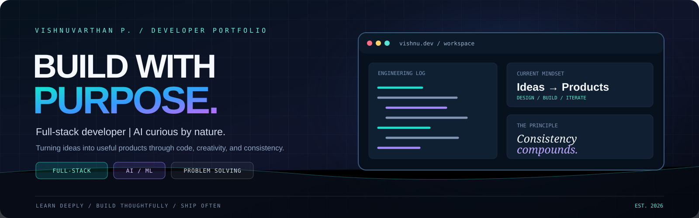
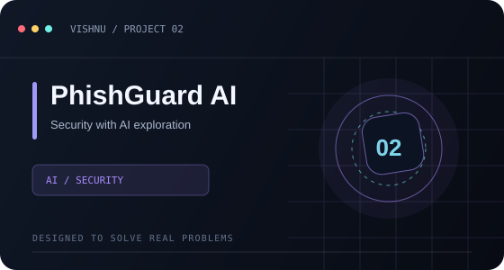
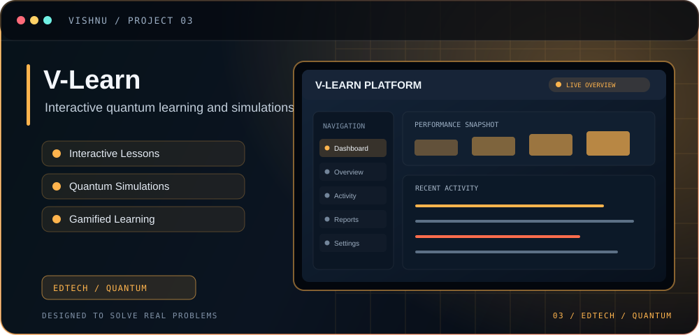

<!-- VISHNUVARTHAN P / PROFILE README — refined developer studio -->

<strong>FULL-STACK DEVELOPER</strong> &nbsp; · &nbsp; <strong>AI BUILDER</strong> &nbsp; · &nbsp; <strong>PRODUCT THINKER</strong>

 

BUILDING WITH PURPOSE · LEARNING IN PUBLIC · IMPROVING EVERY ITERATION

 

<table>
<tr>
<td width="60%" valign="top">

## 01 / ABOUT THE BUILDER

### Hey, I’m Vishnu. 👋

I’m a **B.Tech Information Technology student** focused on building practical digital products with full-stack engineering and AI.

I enjoy taking ideas from rough concepts to working software — with thoughtful interfaces, useful features, and room to improve.

**WHAT I'M INTO**

- **Engineering:** React, TypeScript, Node.js, Python
- **Exploring:** AI applications, automation, developer tools
- **Building:** Products that are useful, clear, and approachable

</td>
<td width="40%" valign="top">

## 02 / AT A GLANCE

| **FOCUS** | Full-stack + AI |
|:--|:--|
| **BASE** | Tamil Nadu, India |
| **APPROACH** | Design → Build → Iterate |

 

</td>
</tr>
</table>

---

## 03 / FEATURED PROJECTS

*A selection of projects exploring campus tools, AI, cybersecurity, and interactive learning.*

 &nbsp;  &nbsp; 

<table>
<tr>
<td width="50%" valign="top">

### EduSmart

Digital campus workflows and student-facing tools.

`CAMPUS TECH` · `WEB APP`

<a href="https://github.com/vishnu-techub/Edusmart">VIEW PROJECT ↗</a>

</td>
<td width="50%" valign="top">

### PhishGuard AI

An AI-oriented cybersecurity project exploring safer digital experiences.

`AI` · `CYBERSECURITY`

<a href="https://github.com/vishnu-techub/PhishGuard-AI">VIEW PROJECT ↗</a>

</td>
</tr>
<tr>
<td width="50%" valign="top">

### V-Learn

An interactive learning concept for exploring quantum-computing concepts.

`EDTECH` · `QUANTUM`

<a href="https://github.com/vishnu-techub/v-learn">VIEW PROJECT ↗</a>

</td>
<td width="50%" valign="top">

### Digital Mentor–Mentee

A platform for mentoring, counselling records, and student-development workflows.

`REACT` · `NODE.JS` · `MONGODB`

<a href="https://github.com/vishnu-techub/DIGITAL-MENTOR-MENTEE">VIEW PROJECT ↗</a>

</td>
</tr>
</table>

<a href="https://github.com/vishnu-techub/campus-stack">CampusStack ↗</a> &nbsp; · &nbsp;
<a href="https://github.com/vishnu-techub/url-shotner">URL Shortener ↗</a> &nbsp; · &nbsp;
<a href="https://github.com/vishnu-techub?tab=repositories">All repositories ↗</a>

---

## 04 / TECH STACK

*A growing toolkit for building, testing, and shipping software.*

**FRONTEND**

**BACKEND · DATA · WORKFLOW**

---

## 05 / OPEN-SOURCE ACTIVITY

 

---

<table>
<tr>
<td width="68%" valign="middle">

## 06 / LET'S CONNECT

Have an interesting idea, a useful problem to solve, or want to collaborate? Let’s connect.

**Learn deeply. Build thoughtfully. Ship often.**

</td>
<td width="32%" align="center" valign="middle">

  

</td>
</tr>
</table>

